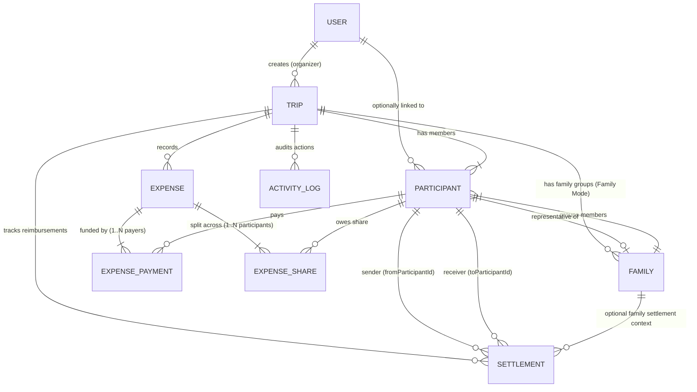

# TripLedger — Database Architecture

## 1. Core Database Principles

1. **Normalized Financial Collections:** Expenses, payments (`ExpensePayments`), obligations (`ExpenseShares`), and reimbursements (`Settlements`) are stored in dedicated collections. Settlements never mutate or masquerade as expenses.
2. **Integer Paisa Storage:** Every monetary field (`amountPaisa`, `budgetPaisa`, `paidPaisa`, `sharePaisa`, `packageRatePaisa`) is stored as a signed/unsigned 64-bit safe integer in **paisa** (`NPR 1 = 100 paisa`). Schema validators reject non-integer or negative values.
3. **Trip-Level Isolation:** Every trip resource (`Participant`, `Family`, `Expense`, `ExpensePayment`, `ExpenseShare`, `Settlement`, `ActivityLog`) carries an indexed `tripId` reference. All queries filter by `tripId`.
4. **Historical Preservation & Soft Reversal:** Financial records (`Expense`, `Settlement`) are never hard-deleted once active. Cancelled or superseded expenses are marked `isDeleted: true` with `deletedAt` and `deletedBy` metadata, and excluded from active balance calculations while remaining visible in audit logs.

---

## 2. Entity-Relationship Diagram

---

## 3. Collection Schemas & Indexes

### 3.1 `Users` (`users`)
Stores registered platform accounts. Note that trip participants do not need a `User` document unless they register or link their account.
- `_id`: `ObjectId`
- `name`: `String` (required, trimmed)
- `email`: `String` (required, unique, lowercase, indexed)
- `passwordHash`: `String` (required, `select: false`)
- `phone`: `String` (optional)
- `defaultCurrency`: `String` (default: `'NPR'`)
- `refreshTokenHash`: `String` (optional, `select: false`)
- `createdAt`, `updatedAt`: `Date`

### 3.2 `Trips` (`trips`)
Represents a Friends Mode or Family Mode trip container.
- `_id`: `ObjectId`
- `name`: `String` (required, trimmed)
- `description`: `String` (optional)
- `mode`: `Enum ['FRIENDS', 'FAMILY']` (required, immutable after creation)
- `status`: `Enum ['PLANNING', 'ACTIVE', 'REVIEW', 'CLOSED']` (default: `'ACTIVE'`)
- `currency`: `String` (default: `'NPR'`)
- `budgetPaisa`: `Number` (integer `>= 0`, optional)
- `startDate`: `Date` (optional)
- `endDate`: `Date` (optional)
- `createdBy`: `ObjectId` (ref: `'User'`, required)
- `inviteCode`: `String` (unique, indexed)
- `shareToken`: `String` (unique, indexed, for read-only public summary sharing)
- `shareEnabled`: `Boolean` (default: `true`)
- `checklist`: Array of `{ category: String, label: String, checked: Boolean, notApplicable: Boolean, verifiedAt: Date }` (Forgotten Expense Protection checklist state)
- `closedAt`: `Date` (optional)
- `createdAt`, `updatedAt`: `Date`

**Indexes:** `{ createdBy: 1, status: 1 }`, `{ inviteCode: 1 }`, `{ shareToken: 1 }`

### 3.3 `Families` (`families`)
Used in `FAMILY` mode trips (and optionally available if organizing sub-groups) to group participants into family units with a designated representative.
- `_id`: `ObjectId`
- `tripId`: `ObjectId` (ref: `'Trip'`, required, indexed)
- `name`: `String` (required, e.g., `"Sharma Family"`)
- `representativeId`: `ObjectId` (ref: `'Participant'`, optional until members are created)
- `defaultWeight`: `Number` (default: `1`, `> 0`)
- `notes`: `String` (optional)
- `createdAt`, `updatedAt`: `Date`

**Indexes:** `{ tripId: 1, name: 1 }` (unique per trip)

### 3.4 `Participants` (`participants`)
Represents an individual person in a trip (either a guest managed by the organizer or a linked registered user).
- `_id`: `ObjectId`
- `tripId`: `ObjectId` (ref: `'Trip'`, required, indexed)
- `userId`: `ObjectId` (ref: `'User'`, nullable/optional — supports Guest Participants)
- `familyId`: `ObjectId` (ref: `'Family'`, nullable/optional)
- `name`: `String` (required, trimmed)
- `email`: `String` (optional, lowercase — used to auto-link or invite)
- `phone`: `String` (optional)
- `role`: `Enum ['ORGANIZER', 'CONTRIBUTOR', 'FAMILY_REP', 'PARTICIPANT']` (default: `'PARTICIPANT'`)
- `memberType`: `Enum ['ADULT', 'CHILD', 'DEPENDENT']` (default: `'ADULT'`)
- `defaultWeight`: `Number` (default: `1.0`, `>= 0` — configurable weight for weighted splitting; never hardcoded by age)
- `isActive`: `Boolean` (default: `true`)
- `createdAt`, `updatedAt`: `Date`

**Indexes:** `{ tripId: 1, isActive: 1 }`, `{ tripId: 1, userId: 1 }`, `{ tripId: 1, familyId: 1 }`

### 3.5 `Expenses` (`expenses`)
Stores the master expense header. Individual payments and participant shares are stored in `ExpensePayments` and `ExpenseShares`.
- `_id`: `ObjectId`
- `tripId`: `ObjectId` (ref: `'Trip'`, required, indexed)
- `title`: `String` (required, trimmed)
- `description`: `String` (optional)
- `category`: `Enum ['TRANSPORTATION', 'FUEL', 'ACCOMMODATION', 'FOOD_DRINKS', 'SNACKS_WATER', 'PARKING_TOLLS', 'ENTRY_FEES', 'ACTIVITIES', 'PACKAGE', 'SHOPPING', 'MISCELLANEOUS']`
- `amountPaisa`: `Number` (integer `> 0`, required)
- `isEstimated`: `Boolean` (default: `false` — supports Forgotten Expense Protection pending estimated expenses)
- `isPackage`: `Boolean` (default: `false` — identifies fixed per-person/package expenses in Family Mode)
- `packageConfig`: `{ ratePerUnitPaisa: Number, unitCount: Number }` (optional metadata when `isPackage === true`)
- `splitMethod`: `Enum ['EQUAL', 'CUSTOM', 'SELECTIVE', 'PER_FAMILY', 'WEIGHTED', 'PACKAGE']`
- `paymentMethod`: `Enum ['CASH', 'ESEWA', 'KHALTI', 'FONEPAY', 'BANK_TRANSFER', 'CARD', 'OTHER']` (default: `'CASH'`)
- `approvalStatus`: `Enum ['APPROVED', 'PENDING_APPROVAL', 'PENDING_CONFIRMATION', 'REJECTED']` (default: `'APPROVED'` when created by Organizer, `'PENDING_APPROVAL'` when submitted by Contributor, `'PENDING_CONFIRMATION'` when created as an estimated placeholder)
- `incurredAt`: `Date` (default: `Date.now`)
- `createdByParticipantId`: `ObjectId` (ref: `'Participant'`, required)
- `approvedByParticipantId`: `ObjectId` (ref: `'Participant'`, optional)
- `clientMutationId`: `String` (optional — UUID for offline PWA idempotency)
- `isDeleted`: `Boolean` (default: `false`)
- `deletedAt`: `Date` (optional)
- `createdAt`, `updatedAt`: `Date`

**Indexes:**
- `{ tripId: 1, isDeleted: 1, incurredAt: -1 }`
- `{ tripId: 1, clientMutationId: 1 }` (unique, sparse — prevents duplicate offline sync creation)

### 3.6 `ExpensePayments` (`expense_payments`)
Records who actually paid money toward an expense (supports single payer or multiple contributors per expense).
- `_id`: `ObjectId`
- `tripId`: `ObjectId` (ref: `'Trip'`, required, indexed)
- `expenseId`: `ObjectId` (ref: `'Expense'`, required, indexed)
- `participantId`: `ObjectId` (ref: `'Participant'`, required)
- `amountPaisa`: `Number` (integer `> 0`, required)
- `paymentMethod`: `Enum ['CASH', 'ESEWA', 'KHALTI', 'FONEPAY', 'BANK_TRANSFER', 'CARD', 'OTHER']`
- `paidAt`: `Date` (default: `Date.now`)
- `notes`: `String` (optional)

**Indexes:** `{ expenseId: 1 }`, `{ tripId: 1, participantId: 1 }`

### 3.7 `ExpenseShares` (`expense_shares`)
Records the exact integer paisa obligation assigned to each participant for an expense.
- `_id`: `ObjectId`
- `tripId`: `ObjectId` (ref: `'Trip'`, required, indexed)
- `expenseId`: `ObjectId` (ref: `'Expense'`, required, indexed)
- `participantId`: `ObjectId` (ref: `'Participant'`, required)
- `familyId`: `ObjectId` (ref: `'Family'`, optional — captured for audit clarity)
- `sharePaisa`: `Number` (integer `>= 0`, required)
- `weightUsed`: `Number` (optional — records weight or custom parameter used during calculation)

**Indexes:** `{ expenseId: 1 }`, `{ tripId: 1, participantId: 1 }`

### 3.8 `Settlements` (`settlements`)
Records direct reimbursements between participants (or family representatives). Never treated as an expense.
- `_id`: `ObjectId`
- `tripId`: `ObjectId` (ref: `'Trip'`, required, indexed)
- `settlementMode`: `Enum ['INDIVIDUAL', 'FAMILY']` (default: `'INDIVIDUAL'`)
- `fromParticipantId`: `ObjectId` (ref: `'Participant'`, required — sender/payer of reimbursement)
- `toParticipantId`: `ObjectId` (ref: `'Participant'`, required — receiver of reimbursement)
- `fromFamilyId`: `ObjectId` (ref: `'Family'`, optional)
- `toFamilyId`: `ObjectId` (ref: `'Family'`, optional)
- `amountPaisa`: `Number` (integer `> 0`, required)
- `paymentMethod`: `Enum ['CASH', 'ESEWA', 'KHALTI', 'FONEPAY', 'BANK_TRANSFER', 'CARD', 'OTHER']`
- `status`: `Enum ['PENDING', 'REPORTED', 'CONFIRMED', 'REJECTED']` (default: `'REPORTED'`)
- `referenceNote`: `String` (optional)
- `settledAt`: `Date` (default: `Date.now`)
- `reportedByParticipantId`: `ObjectId` (ref: `'Participant'`, required)
- `confirmedByParticipantId`: `ObjectId` (ref: `'Participant'`, optional)
- `confirmedAt`: `Date` (optional)
- `isDeleted`: `Boolean` (default: `false`)
- `createdAt`, `updatedAt`: `Date`

**Indexes:** `{ tripId: 1, status: 1, isDeleted: 1 }`, `{ tripId: 1, fromParticipantId: 1 }`, `{ tripId: 1, toParticipantId: 1 }`

### 3.9 `ActivityLogs` (`activity_logs`)
Immutable audit trail of important financial and structural actions within a trip.
- `_id`: `ObjectId`
- `tripId`: `ObjectId` (ref: `'Trip'`, required, indexed)
- `actorUserId`: `ObjectId` (ref: `'User'`, optional)
- `actorParticipantId`: `ObjectId` (ref: `'Participant'`, optional)
- `actorName`: `String` (required)
- `actionType`: `String` (e.g., `'TRIP_CREATED'`, `'EXPENSE_ADDED'`, `'EXPENSE_EDITED'`, `'EXPENSE_APPROVED'`, `'SETTLEMENT_REPORTED'`, `'SETTLEMENT_CONFIRMED'`, `'TRIP_CLOSED'`)
- `entityType`: `Enum ['TRIP', 'PARTICIPANT', 'FAMILY', 'EXPENSE', 'SETTLEMENT']`
- `entityId`: `ObjectId`
- `summary`: `String` (human-readable audit message)
- `metadata`: `Mixed` (JSON snapshot of before/after values in paisa)
- `createdAt`: `Date` (indexed)
